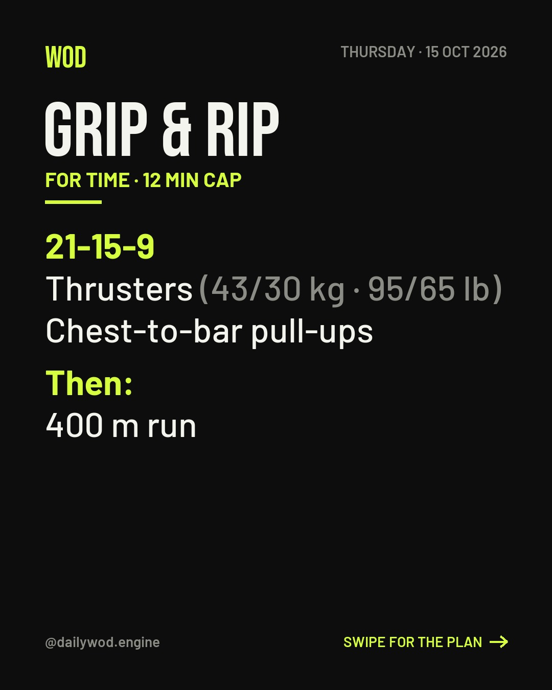

# Dagens WOD-agent

En AI-agent som driver ett Instagramkonto med ett nytt träningspass (WOD) varje dag. Claude är coachen och allt körs gratis i GitHub Actions.



**Vad den gör varje morgon**
1. **Skriver dagens pass.** Coachen följer veckoschemat i `varumarke.md` och tittar på de senaste tre veckornas pass, så att rörelser, tidsdomäner och muskelgrupper varierar. Varje pass har vikter i kg och lb, tempotips och tre nivåer: Rx, Intermediate och Beginner.
2. **Gör en karusell med tre bilder** i formatet 1080 × 1350:
   1. **Passet.**
   2. **Planen:** coachens kommentar, tempotips och de tre nivåerna.
   3. **Dela:** en uppmaning att skicka passet till en träningskompis, tagga någon eller lägga sin tid. Texten växlar från dag till dag.
3. **Publicerar på Instagram.** Inlägget får en bildtext med passet, coachens kommentar och hashtags. Den uppmanar folk att lägga sina resultat i kommentarerna och att skicka passet till en träningskompis.

Vill du hellre ha en enda bild per dag, se [Karusell eller en bild](#karusell-eller-en-bild).

Alla pass skrivs från grunden av agenten. Den kopierar aldrig andras pass och använder aldrig ordet "CrossFit", som är ett skyddat varumärke.

---

## Det här behöver du

- Ett Instagramkonto av typen **Business** eller **Creator**. Välj ett namn utan ordet "CrossFit", till exempel *dailywod.engine*.
- Ett Facebook-konto för att logga in på Meta for Developers.
- Ett GitHub-konto. Det är gratis.
- En API-nyckel till Claude. API:t debiteras per användning, separat från en Claude-prenumeration.

---

## Installation

### 1. Skapa Instagramkontot
Skapa kontot och byt till ett professionellt konto (Business eller Creator) under kontoinställningarna i appen. Kontot måste vara publikt, annars går det inte att hämta en token.

### 2. Skapa en Meta-app och hämta en token
Du behöver ingen Facebook-sida, ingen företagsverifiering och ingen App Review. Appen kan ligga kvar i utvecklingsläge eftersom den bara används för ditt eget konto. Menyerna kan visas på svenska; här står de engelska namnen.

**Skapa appen**
1. Gå till [developers.facebook.com/apps](https://developers.facebook.com/apps) och logga in med Facebook. Första gången klickar du **Get Started** och registrerar dig som utvecklare.
2. Klicka **Create App**.
3. **App details:** skriv ett namn, till exempel *Daily WOD Agent*, och din e-post. Klicka **Next**.
4. **Use cases:** välj **Manage messaging & content on Instagram** under kategorin *Content management*. Klicka **Next**.
5. **Business:** välj **I don't want to connect a business portfolio yet**. Klicka **Next**.
6. **Requirements:** klicka **Next**.
7. **Overview:** klicka **Go to dashboard** och ange ditt Facebook-lösenord om du blir tillfrågad.

**Behörigheter**

8. På Dashboard klickar du **Customize** vid *Manage messaging & content on Instagram*. Du hamnar på **API setup with Instagram business login**.
9. Klicka **Add all required permissions** om knappen finns. Kontrollera under **Permissions and features** att `instagram_business_basic`, `instagram_business_content_publish` och `instagram_business_manage_comments` finns med.

**Gör kontot till testare**

10. Gå till **App roles → Roles** i vänstermenyn och klicka **Add People**.
11. Välj **Instagram Tester**, skriv kontots användarnamn utan @ och klicka **Add**. Det står *Pending* tills du har accepterat.
12. Logga in på WOD-kontot och öppna [instagram.com/accounts/manage_access](https://www.instagram.com/accounts/manage_access/). Välj fliken **Tester invites** och klicka **Accept**. I mobilappen: Profil → ☰ → **Website permissions** → **Apps and websites** → **Tester invites**.

**Hämta token**

13. Gå tillbaka till **API setup with Instagram business login**. Under **1. Generate access tokens** klickar du **Add account** och loggar in med WOD-kontot.
14. Klicka **Generate token** vid kontot, kryssa i **I understand** och kopiera token. Den visas bara en gång. Den gäller i 60 dagar och förnyas automatiskt i steg 8.

Resten av sidan (webhooks, business login, App Review) behöver du inte göra något med.

### 3. Skaffa en Claude API-nyckel
Logga in på [platform.claude.com](https://platform.claude.com), lägg till betalning och skapa en nyckel under **API keys**. Ett WOD om dagen kostar bara några få anrop.

### 4. Skapa ett publikt GitHub-repo
1. Gå till [github.com/new](https://github.com/new), döp repot till till exempel `daily-wod` och välj **Public**.
   Repot måste vara publikt eftersom Instagram hämtar bilderna därifrån. Bara koden, bilderna och passen syns. Dina nycklar ligger som hemligheter i steg 5 och är aldrig synliga.
2. Ladda upp alla filer från den här mappen med **Add file → Upload files**.
   Mappen `.github` och filerna `.gitignore` och `.env.example` är dolda på datorn. På Mac visar du dem i Finder med **Cmd + Shift + .**, i Windows under **Visa → Dolda objekt**. Utan `.github` körs ingenting.

### 5. Lägg in hemligheterna
I repot: **Settings → Secrets and variables → Actions → New repository secret**. Lägg till:

| Namn | Värde |
|---|---|
| `ANTHROPIC_API_KEY` | Nyckeln från steg 3 |
| `IG_ACCESS_TOKEN` | Token från steg 2 |

### 6. Anpassa coachen
Öppna `varumarke.md` i repot och klicka på pennan för att redigera. Det går bra från mobilen. Filen är redan ifylld för ett engelskspråkigt konto, men ändra gärna veckoschemat, utrustningen, tonen och hashtagsen.

### 7. Provkör
Gå till fliken **Actions**, välj **Dagens WOD** och klicka **Run workflow**. Efter ett par minuter ligger dagens pass på Instagram. Därefter körs det automatiskt varje morgon.

### 8. Automatisk förnyelse av token
Token från Meta slutar fungera efter 60 dagar. Flödet *Förnya Instagram-token* förnyar den varje måndag, men det behöver lov att spara den nya token:
1. Gå till GitHub **Settings → Developer settings → Personal access tokens → Fine-grained tokens → Generate new token**.
2. Välj bara ditt WOD-repo. Under **Repository permissions** sätter du **Secrets** till **Read and write**.
3. Skapa token och lägg in den som en hemlighet i repot med namnet `GH_PAT`, på samma sätt som i steg 5.
4. Provkör flödet *Förnya Instagram-token* under **Actions**. Token måste vara minst ett dygn gammal innan den kan förnyas.

---

## Karusell eller en bild
Som standard publiceras en karusell med tre bilder. Vill du ha det gamla läget med en enda bild, där skalningen står längst ned på bilden, lägger du till inställningen `WOD_FORMAT` med värdet `bild`:
- **I GitHub:** **Settings → Secrets and variables → Actions → Variables → New repository variable**. Namn `WOD_FORMAT`, värde `bild`. Flödet läser variabeln automatiskt.
- **På datorn:** sätt `WOD_FORMAT=bild` i `.env`.

Med `karusell` eller ingen inställning alls blir det tre bilder. Karusellen räknas som ett inlägg i Instagrams dygnsgräns.

## Ändra publiceringstiden
Öppna `.github/workflows/dagens-wod.yml` och ändra raden `cron: "17 5 * * *"`. Tiden anges i UTC, så 05:17 UTC är 07:17 svensk sommartid och 06:17 vintertid. Vid hög belastning hos GitHub kan schemalagda körningar bli några minuter sena.

## Om något går fel
GitHub mejlar dig när ett schemalagt flöde misslyckas. Öppna körningen under **Actions** för att se felet.

| Fel | Lösning |
|---|---|
| `Invalid OAuth access token` | Token har gått ut. Hämta en ny enligt steg 2 och byt ut hemligheten `IG_ACCESS_TOKEN`. Kontrollera sedan steg 8. |
| `Bilden går inte att nå på den publika adressen` | Repot är troligen privat. Gör det publikt under **Settings → General → Danger Zone**. |
| `Saknar ANTHROPIC_API_KEY` | Hemligheten saknas eller är felstavad. |
| `Hemligheten GH_PAT saknas` | Gör steg 8. |
| `Dygnsgränsen är nådd` | Instagram tillåter högst 100 publiceringar per dygn via API:t. Det händer bara om något körts väldigt många gånger. |
| Schemat har slutat köras | GitHub pausar schemalagda flöden i publika repon efter 60 dagar utan aktivitet. Aktivera flödet igen under **Actions**. |

---

## På din egen dator

Du kan prova agenten lokalt, till exempel för att se hur passen och bilderna blir innan du kopplar på GitHub.

```bash
python3 -m venv .venv
source .venv/bin/activate        # Windows: .venv\Scripts\activate
pip install -r requirements.txt
cp .env.example .env             # fyll i ANTHROPIC_API_KEY och IG_ACCESS_TOKEN

python main.py status                        # kontrollera kopplingen
python main.py wod-skapa --torrkorning       # dagens pass och bild, sparas inte
python main.py wod-skapa                     # som ovan men du kan ge feedback och spara
```
Bilderna hamnar i mappen `bilder`, som `2026-10-15-1.jpg` till `-3.jpg`. Med `--torrkorning` publiceras ingenting.

### Svara på kommentarer
Agenten kan också gå igenom kommentarer, svara på frågor och gratulera till bra tider. Den flaggar sådant som du själv behöver ta i `flaggade.md`.
```bash
python main.py kommentarer               # du godkänner varje svar
python main.py kommentarer --auto        # svarar själv
```

### Andra inlägg
Vill du lägga upp egna bilder, till exempel från en träning, lägger du dem i `ko.json` och kör `python main.py posta`. Agenten skriver då bildtexten.

---

## Filerna

| Fil | Vad den är |
|---|---|
| `varumarke.md` | Coachens instruktioner: ton, veckoschema, utrustning, regler |
| `wods.json` | Alla pass som skapats, nyast först. Coachen använder dem för att variera. |
| `bilder/` | Bilderna som Instagram hämtar |
| `main.py` | Kommandona: `status`, `wod-skapa`, `wod-publicera`, `kommentarer`, `posta`, `fornya-token` |
| `wod.py` | Coachen som skriver passen |
| `bild.py` | Ritar bild 1, passet (och den enda bilden i läget `bild`) |
| `karusell.py` | Ritar bild 2, planen, och bild 3, uppmaningen att dela, och sätter ihop karusellen |
| `agent.py` | Bildtexter för egna bilder och kommentarsagenten |
| `instagram_api.py` | Anropen till Instagrams API |
| `.github/workflows/` | De schemalagda flödena i GitHub Actions |
| `fonts/` | Typsnitten Bebas Neue och Barlow (fri licens, SIL OFL) |
